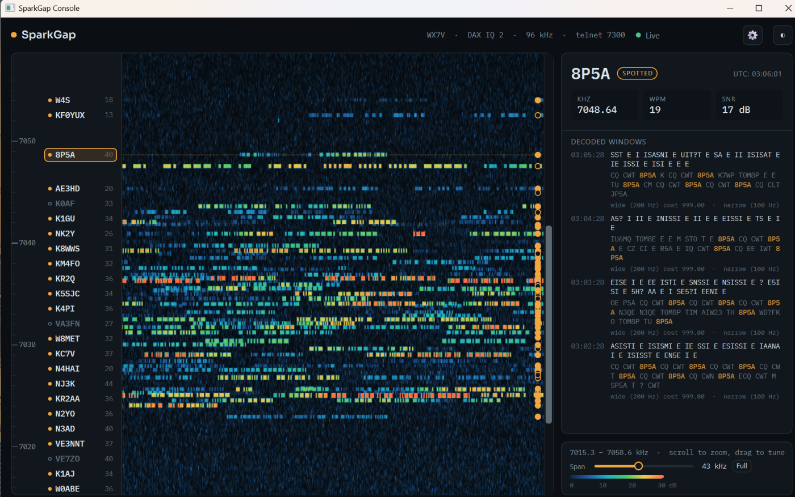

# SparkGap Console (experimental)

A desktop client that shows what a running SparkGap hears: a live waterfall of
the receiver's span, the calls on a frequency ladder, and the decoded text of
the signal you pick. SparkGap stays an independent service next to the radio;
the console connects to it over the network and can come and go without
disturbing decoding. One console can watch several SparkGaps.



Status: experimental. Settings are shown read-only; changing them will come with
a launcher.

## Server: the feed

The feed is off unless the config has a `gui_feed` block:

```json
"gui_feed": {"bind": "127.0.0.1", "port": 7320, "join_code": null}
```

- `bind`: the address to listen on. `127.0.0.1` serves only the same machine. To
  watch from other machines, bind the Tailscale address of the SparkGap host;
  the feed is then reachable from your tailnet and nothing else.
- `port`: 7320 by default.
- `join_code`: required whenever `bind` is not a loopback address. Six
  characters, as SKCCLogger's relay uses them; case, spaces and dashes are
  ignored on entry. Make one with `python3 feed_server.py --new-code`. SparkGap
  logs the code at startup:

  ```text
  GUI feed on ws://100.64.0.1:7320/feed, join code XXX-XXX
  ```

- Five wrong codes from one address lock that address out for 10 minutes.
- At most 16 consoles at once; one that stops reading is disconnected.
- `tls_cert` and `tls_key` (optional) serve `wss://`. Tailscale already encrypts
  the link. Settings adds servers as `ws://`, so give a `wss://` server on the
  command line.

The feed works in live and file mode and needs no extra Python packages on the
server. Its spectrum costs under 1% of a core, and nothing while no client is
connected.

## Console: running from source

Python 3.10 or later, from the `gui` folder:

```sh
python3 -m venv .venv
.venv/bin/pip install -r requirements.txt
.venv/bin/python console.py
```

On Windows, `run_console.bat` does the same on first run.

Add servers in Settings, under CONNECTIONS: address, port and join code. The
list is kept between runs. Servers given on the command line are added to it:

```sh
.venv/bin/python console.py ws://100.64.0.1:7320/feed#XXX-XXX
```

The console draws with Qt's software renderer, which costs far less CPU over
remote desktop. `--gpu` uses the graphics card instead.

## Console: Windows build

On Windows, from the `gui` folder, with the venv above:

```bat
.venv\Scripts\pip install pyinstaller
.venv\Scripts\pyinstaller --noconfirm SparkGapConsole.spec
```

The result is `dist\SparkGapConsole`, a folder of about 125 MB with
`SparkGapConsole.exe`. It runs on any Windows PC without Python; copy the whole
folder. Settings shows the build's commit when a `build.txt` holding it sits
next to the spec at build time.

## Using it

- Drag or two-finger drag pans the waterfall; Ctrl+scroll or a pinch zooms; the
  arrows at the scroll bar's ends nudge it. The Span slider and Full button set
  the width.
- Click a trace or a call to see its decoded windows. Ctrl+F searches calls,
  decoded text and frequencies.
- Window size, position and theme are kept between runs.
