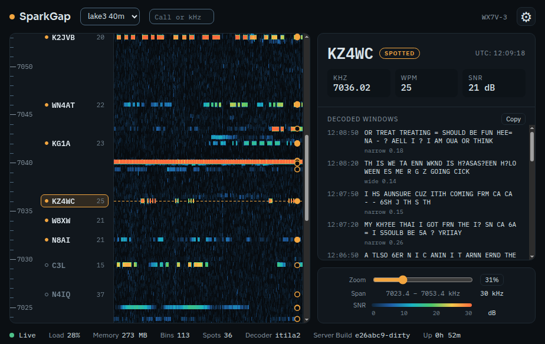
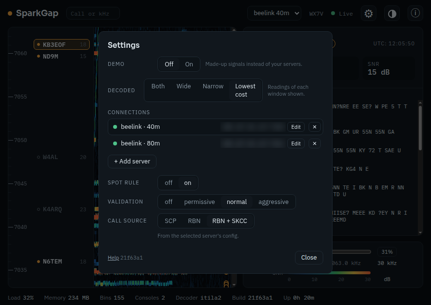
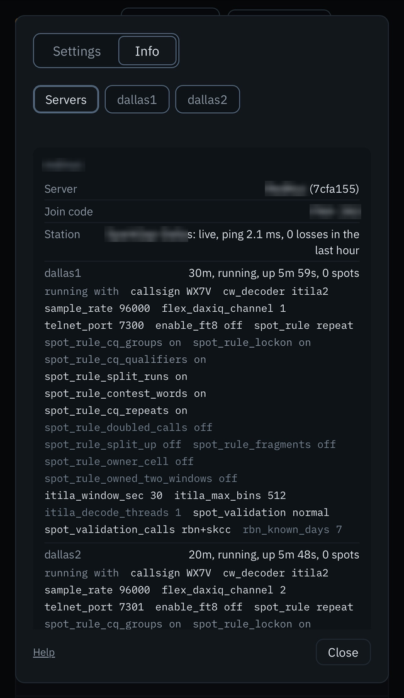

# SparkGap Web (experimental)

SparkGap Web shows your SparkGap skimmers in a web browser. You see the band
as a waterfall, every call SparkGap hears marked by frequency, and the CW it
copies from the station you pick. From the same page you can start and stop a
skimmer, move it to another band, and change how it spots. Nothing to install:
any browser on your network will do, and closing the page does not affect the
skimmers.

## Getting connected

You need two things from whoever set up SparkGap on the radio's computer: the
page's address (for example `http://192.168.1.20:7320/`) and a six-character
join code (for example `KTR-49X`).

1. Open the address in your browser.
2. Click **+ Add server**, enter the address and the join code, and save.
3. The waterfall starts. If the computer runs more than one skimmer, pick one
   from the band list at the top.

**⚙**, **Settings**, **Servers** lists each server you added, with the
skimmers it runs.

The page remembers the server, so next time it opens straight to the
waterfall. A wrong code five times in a row locks your browser out for ten
minutes.

## The main screen

- **Waterfall**: the whole band the skimmer listens to. Signals are the bright
  traces.
- **Call ladder**, beside the waterfall: every signal by frequency. Spotted
  calls stand out, calls heard but not spotted are dimmer, and signals with no
  call yet show only their frequency.
- **Decoded text**, on the right: click a trace or a call to see what SparkGap
  copied from that station, newest first, with its frequency, speed and signal
  strength. You can select the text, or **Copy** all of it. With both readings
  shown, the one SparkGap is surer of (the lower timing cost) is in bold; a
  reading that copied nothing shows as *(nothing decoded)*.
  Where two stations sit close together, such as the two sides of a QSO, a
  click on the trace picks the one sending now; the other has its own row in
  the call ladder.
- **Switching skimmers**: each skimmer comes back on the signal you last
  picked on it. Two skimmers that hear the same frequency (two antennas or
  radios on one band) keep the same signal, so you can compare their copy
  back and forth.
- **Search** (Ctrl+F): type a call, some text or a frequency in kHz to jump to
  it. With the ⚙ dialog open, Ctrl+F is the browser's own find instead.
- **Zoom**: drag to move along the band; Ctrl+scroll or pinch to zoom. The
  **Zoom** button steps through the whole band, half and a quarter. Each
  skimmer opens at the zoom you last left it at, in this browser.
- **Bottom bar**: the connection (a green dot and Live when all is well),
  how hard the computer is working, how many calls the skimmer
  has spotted, and how long it has been running.
- **?** (inside the ⚙ dialog): this guide and what's new.

## Running a skimmer

Click **⚙**, then the skimmer's tab (its name, such as `shack40`).

- The top card shows whether it runs. **Run** on starts it and off stops it;
  off then on restarts it. **Recording** and **AFC** are there too. **Show**
  on the **Servers** tab puts a skimmer on the main screen.
- To change a setting, pick the new value and click **Apply**, which appears
  in the top card. You can change several at once; they take effect together.
  **Discard** forgets them.
- **Radio**: the band, and on a FlexRadio the antenna, RF gain and loops as
  the radio has them right now, however they were set: here, in SmartSDR or
  Maestro, or by another skimmer. They follow the radio within a couple of
  seconds. A change here goes to the radio straight away and does not touch
  the skimmer's config.
- **Startup Config**, at the top of the Radio card: the band, antenna and RF
  gain the skimmer starts with (`the radio's` where none is set: it starts
  with whatever the radio has). **Save Config** saves what the radio has now
  as the startup values; it is greyed out when they already match.
- Antenna, loops and RF gain are shared: on a FlexRadio, every panadapter on
  the same receiver (SCU) has the same antenna and RF gain, and the radio
  decides which SCU a panadapter uses. Changing one skimmer can change
  another, or an operator's panadapter in SmartSDR or Maestro.
- **Decoder Options** (click to open): the decode window, call validation,
  the known call list and the spot rule's options. The line beside it sums
  them up.
- **Window**: how much signal each decoded window holds. Shorter windows show
  text sooner but give the decoder less signal to work from and use more
  CPU; 15 and 7.5 s are untried.
- **Band**: changes straight away while the skimmer runs, in about a second,
  and the waterfall starts over on the new band. Other settings restart the
  skimmer, which takes about half a minute. A skimmer set up to listen at an
  exact frequency rather than a band shows that frequency first in the list,
  for example `7038.0 kHz`; picking a band name moves it to that band.

Settings, in plain terms:

- **Recording**: saves the raw signal to disk so it can be replayed later. It
  uses a lot of space (it needs at least 5 GB free); leave it off unless you
  were asked to record.
- **Call validation**: how sure SparkGap must be before it spots a call.
  Permissive spots more calls but gets more wrong; aggressive spots fewer but
  surer ones. Normal suits most stations. Off uses no score: a call is spotted
  once it is copied a set number of times (2, 3 or 4, by how common its
  pattern is), and the known call list is not used.
- **AFC**: each signal's decoder follows the signal's own tone, which helps
  weak signals and ones slightly off tune. Changing it restarts the skimmer.
  It acts only with the itila2 decoder and is greyed out with any other.
- **Known call list**: calls on this list count as more likely to be right.
  SCP is the contest call list; RBN adds calls other RBN skimmers heard in the
  past week; RBN + SKCC adds the SKCC roster, good for hand-keyed CW.
- **Spot rule options**, under Decoder Options: each changes which calls are
  spotted. All are off unless set. A config with `local_spot_rule` keeps its
  own validation and spot rule for the local port, which these settings do not
  change. Some spot more calls with some risk of a wrong one:
  - **Split runs**: reads `CQCQDE` as `CQ CQ DE`, for fists that run words
    together.
  - **Contest words**: treats CWT, SST or MST before a call like CQ, for
    runners who skip the CQ.
  - **CQ repeats**: spots a station sooner when it sends CQ several times in a
    row.

  Others keep wrong calls out, such as **Owner listed**, **Fragments** and
  **Strongest copy**. **Decoder SNR** measures a spot's signal the way CW
  Skimmer does.

Hover over a setting for a one-line reminder.

The **Servers** tab under Settings lists each server's skimmers, each with
its run switch, and **Start all** and **Stop all**.

## When something looks wrong

Click **⚙**, then **Info**. Each skimmer's tab has a line at the top: green
means the radio is connected and decoding keeps up. Otherwise it says what is
wrong, worst first. Common ones:

- **Radio reconnecting** or **Radio reconnected**: SparkGap lost the radio for
  a moment, usually a network hiccup, and reconnects by itself. If it stays
  down, check the radio and its network cable.
- **Decoder behind**: the computer is too busy to keep up. Close other
  programs, or run fewer skimmers.
- **Clock not NTP synchronised**: the computer's clock is not set from the
  internet. Spot times will be off; turn on automatic time.
- **A stopped skimmer**: its tab shows why. Turn **Run** on; if it stops again,
  send the message to whoever set it up.

The **Servers** tab under Info shows each server's join code (masked: click
it to show it, **Copy** puts it on the clipboard), its skimmers, and the
server's log: every start, stop and setting change, with its result.
The log is the first thing to look at, and the thing to send along when
asking for help.

Under each running skimmer, **running with** lists every setting it is using
right now, as the skimmer itself reports it. That can differ from what
Settings shows if a setting was changed but the skimmer has not restarted
yet. Settings in full colour were set for this skimmer; dimmer ones are built
into the spot rule; the dimmest are left at SparkGap's default. Hover over one
to see which.

A skimmer's own tab under Info shows its health, counts, radio and SparkGap.
On a FlexRadio the radio card shows the skimmer's slice (with the letter
SmartSDR shows), its antenna and RF gain as the radio has them, and its DAX-IQ
channel. A stopped skimmer shows the same cards, empty.

## This browser

Under **⚙**, **Settings**, **Servers**:

- **Theme**: dark or light.
- **Decoded text**: SparkGap reads each signal twice, through a wide and a
  narrow filter. **Lowest cost** (the default) shows whichever it is surer of;
  you can show both, or only one.

## What's new

- **2026-10-28.** The radio card follows the radio: antenna, RF gain and
  loops changed in SmartSDR, Maestro or by another skimmer show within a
  couple of seconds. **Startup Config** shows what a skimmer starts with, and
  **Save Config** saves the radio's current values. A change here no longer
  changes the config by itself. Info shows the slice, antenna and DAX-IQ
  channel; a stopped skimmer shows its cards empty. AFC moved to the top card.
  Removing a server asks first.
- **2026-10-27.** The surer of the two readings is in bold, and a reading that
  copied nothing says so. AFC can be switched per skimmer. Each skimmer keeps
  the signal you last picked on it. Ctrl+F finds text inside the ⚙ dialog.
  A band change clears the old signal. The ⚙ dialog has its own **?** for
  help and this list. A skimmer's settings are in three cards (the skimmer
  with Apply, Radio, Decoder Options) with more of the decoder's options, and
  the Servers tab starts and stops skimmers.
- **2026-10-26.** Spots, not consoles, in the bottom bar; a band change
  counts spots and calls from zero.

## Setting it up

Installing SparkGap and its server, addresses, join codes and remote access
are in [SERVER_SETUP.md](SERVER_SETUP.md).
